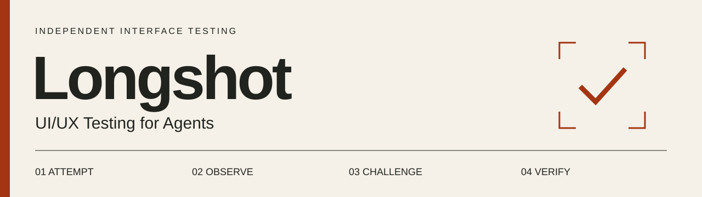

# Longshot

**An independent agent skill for testing human-facing interfaces.** Longshot attempts realistic tasks, challenges design assumptions, and returns reproducible findings with recommendations you can verify.

[Visit the Website](https://jongos.github.io/Longshot/) · [Read the Skill](skills/longshot-human-centered-ui/SKILL.md) · [Validation](validation/rename-independent-role.md) · [Report an Issue](https://github.com/jongos/Longshot/issues)

> **Your design has a point of view. Give it a second pair of eyes.**
>
> No tester available? Give Longshot a goal and let it put your interface through its paces. It attempts the task, shows where the experience breaks down, and returns evidence you can act on. Agent observations do not replace research with real people.

**Start here:** [Install and Invoke](#install-and-invoke) · [Use Cases](#what-you-can-use-it-for) · [Example Finding](#a-finding-you-can-act-on) · [Review Loops](#how-the-loops-work) · [Companion Projects](#dazzler-style-science-and-longshot)

```sh
npx skills add jongos/Longshot --skill longshot-human-centered-ui
```

A companion to **[Dazzler](https://github.com/jongos/Dazzler)** and **[Style Science](https://github.com/jongos/style-science)**: Dazzler creates and refines the interface; Style Science makes its design reasoning and constraints inspectable; Longshot independently tests the experience. Use them together or use Longshot on its own.

Longshot is deliberately skeptical of the happy path, including the one a designer or superuser prefers. It asks whether the interface supports the user's task, follows the evidence, and reports supported strengths as well as flaws. It does not manufacture criticism to look useful.

## What You Can Use It For

| Situation | What Longshot Investigates |
| --- | --- |
| Before shipping a workflow | Discoverability, terminology, choices, feedback and meaningful completion |
| A form or editor spans several screens | Draft preservation, navigation, interruptions and resuming work |
| A service says it is done | Whether the result is queued, acknowledged or actually verified |
| A task fails or gets cancelled | Actionable errors, recovery, undo and uncertain outcomes |
| The default interaction excludes someone | Relevant keyboard, focus, zoom, overflow and responsive behavior |
| The design team agrees too quickly | Counterexamples, unexplained constraints and alternatives to the prescribed route |

The intended benefit is a more actionable review: fewer unsupported assertions, clearer priorities, preserved safeguards and concrete acceptance tests. These are the skill's goals, not measured claims of improved human outcomes.

## A First Encounter, Then a Diagnosis

Longshot first tries to discover the route using the interface, without reading source code or a designer's click-by-click solution. It records what the available cues suggest before consequential ambiguous actions, then compares those expectations with the actual result. If it already knows the solution, it discloses that limit rather than claiming a fresh perspective.

Only after recording that attempt does it use authorized implementation evidence to investigate. A task completed with hidden information is not reported as unassisted discovery. A control found through an accessibility tree does not prove that its visual presentation is discoverable.

| What It Records | Why It Matters |
| --- | --- |
| Completion: completed, blocked, uncertain or untested | A pending operation is not automatically a failure. |
| Assistance: backtracking, ordinary help or privileged information | A successful workaround can conceal an obstacle in the original route. |
| Conditions: first visit, returning draft, comparison, keyboard, zoom or interruption | Concrete task conditions replace speculative demographic roleplay. |
| Aftermath: find, reopen, correct or recover the result | A success screen is only part of the job. |

Longshot chooses relevant conditions rather than expanding every request into a full audit. It records working behavior as well as obstacles and can return no findings when the evidence supports that conclusion.

## Install and Invoke

With the [Skills CLI](https://skills.sh/docs):

```sh
npx skills add jongos/Longshot --skill longshot-human-centered-ui
```

Or copy `skills/longshot-human-centered-ui` into your agent's discoverable skills directory. For Codex, use `~/.codex/skills/longshot-human-centered-ui/`.

```text
Use $longshot-human-centered-ui to test this demo app.
The intended user is a first-time visitor who needs to prepare a draft
using a required reference, then return later to finish it.
Use only the supplied synthetic test account. Report completion,
assistance needed, reproducible obstacles and acceptance tests.
Do not modify the application.
```

The skill's display name is **Longshot**. Its identifier is **longshot-human-centered-ui**. It replaces the earlier `human-centered-ui-review` identifier; remove an obsolete duplicate installation when upgrading. Automatic selection is enabled for interface testing and usability reviews, not ordinary fixes or factual questions.

Longshot needs a host agent with suitable browser or application tools and an authorized test environment. No separate runtime, paid evaluation service or companion skill is required. A goal, an interface and authorized access are enough to start; no persona questionnaire or prepared test plan is required. Without interaction access, it can review supplied evidence, but must label the result as limited evidence review rather than a live walkthrough.

## How the Loops Work

Longshot specifies bounded review cycles carried out by the host agent:

1. **Attempt:** establish a goal, boundary and completion condition; discover the route through the rendered interface before diagnosis.
2. **Observe:** record action-relevant expectations, outcomes and assistance, distinguishing visual evidence from accessibility-tree, DOM or service evidence.
3. **Challenge:** consider an authorized alternative, interruption or competing explanation. Designer intent is context, not proof.
4. **Verify and report:** check meaningful completion and relevant aftermath, reproduce consequential issues where authorized, and recommend a falsifiable acceptance test.

The cycle stops at the agreed scope, evidence limits or action boundary. An unavailable role is not a product defect. A timeout is not necessarily a failed operation. Never repeatedly submit an uncertain transaction.

A later fix-and-retest cycle requires separate implementation authorization. Longshot does not automatically redesign, run forever, schedule itself or approve its own changes. There is no hidden autonomous repair engine.

## What Comes Back

A report scaled to the request, with:

- Overall disposition, coverage limits and consequential findings first.
- Whether the task completed, what assistance was needed and whether prior knowledge affected discovery.
- A compact journey/state coverage map for the conditions actually attempted.
- Task/state, expected versus observed behavior, reproducible evidence and relevant authorized screenshots.
- Separate classifications for defects, usability concerns and aesthetic preferences; execution limits and cause attribution remain distinct.
- Severity and confidence with explanations, not a composite score that hides critical problems.
- Recommendations addressing the evidenced obstacle, useful behavior to preserve, and acceptance tests that could contradict the recommendation.
- Neutral follow-up tasks for actual human research.

### A Finding You Can Act On

*Synthetic example of report structure, not a result from an actual application.*

| Field | Example |
| --- | --- |
| Task | Create a draft, consult a required reference, return to finish. |
| Evidence | In this fictional fixture, entering text, opening the reference and returning leaves the editor empty. |
| Expected / observed | The in-progress draft remains available / the visible input is cleared. |
| Consequence | The user must re-enter work to continue. Permanent deletion of a stored record is not established. |
| Classification | Defect: lost visible input during a required journey. |
| Severity / confidence | High if the journey requires substantial re-entry; confidence applies only to the stipulated fixture behavior. |
| Recommendation | Preserve the draft across reference navigation. Keep the useful verification requirement. |
| Acceptance test | Enter distinct text in each field, visit the reference, return and verify every value is restored. |

See the [finding template](skills/longshot-human-centered-ui/references/finding-template.md) and [retained research](skills/longshot-human-centered-ui/references/research.md).

Important findings include a replayable record: **starting state → actions → evidence → observed outcome → acceptance test**. Longshot uses existing screenshots and traces when available, states what is missing, and keeps sensitive test content out of reports. Recommendations identify the smallest useful change, safeguards to preserve, tradeoffs and a result that would disprove the expected benefit. Later authorized retesting compares the same conditions and checks for regressions.

## Dazzler, Style Science and Longshot

| Project | Primary Responsibility |
| --- | --- |
| [Dazzler](https://github.com/jongos/Dazzler) | Designs, builds and refines interfaces and visual outputs. Dazzler styled this project's website. |
| [Style Science](https://github.com/jongos/style-science) | Makes design requirements, constraints and supporting evidence inspectable. |
| **Longshot** | Independently tests the experience, including whether declared requirements serve the user's task. |

They share an interest in evidence but do different jobs. Longshot has no runtime dependency on either companion.

## Why Longshot?

Longshot is one of creator Jon Gosier's favorite X-Men characters. Ann Nocenti and Art Adams introduced him in 1985: a luck-powered outsider rebelling against Mojo's entertainment empire. He and Dazzler become teammates and romantic partners; later stories reveal them as Shatterstar's parents.

That makes the companion name a personal comics connection as well as a useful metaphor: question the show and follow what actually happens. The software relies on evidence, not luck.

Sources: [Marvel's Longshot collection](https://www.marvel.com/comics/collection/46821/x-men_longshot_new_printing_trade_paperback), [character history and issue references](https://en.wikipedia.org/wiki/Longshot_(Marvel_Comics)). Independent project; not affiliated with or endorsed by Marvel or Disney. No Marvel artwork is included.

## Validation and Limits

Current validation includes structural checks and small synthetic text-packet exercises. The [original record](validation/RESULTS.md) and [rename/independent-role check](validation/rename-independent-role.md) state exactly what ran. They do not establish broad reliability on rendered applications.

The [walkthrough protocol update](validation/walkthrough-protocol.md) records the limited checks for first-encounter isolation, evidence provenance and recommendation safeguards. Human-grounded benchmark research is planned; a held-out human comparison has not been run. The [evaluation plan](validation/human-grounded-plan.md) defines what would count as stronger evidence without presenting future tests as completed work.

Agent observations are not human participant evidence. Longshot cannot infer human confusion, satisfaction or success rates from its own behavior. Automated accessibility checks and agent keyboard tests do not constitute a complete accessibility assessment.

Review permission does not authorize private-content inspection, paid actions, production changes or deployment. Application changes require separate authorization.

## Contributing

Useful issues include a sanitized task, environment, reproduction steps, observed behavior and expected outcome. Mark simulated service behavior explicitly. Avoid private data, credentials and invented participant results. Include good control cases as well as failures; a new instruction should solve a demonstrated problem without expanding every review into an audit.

## License

Original skill instructions, documentation and website code: [MIT](LICENSE). Bundled Archivo font files retain their [SIL Open Font License](docs/fonts/archivo/OFL.txt) and notices. Character names and comics remain the property of their respective owners.
